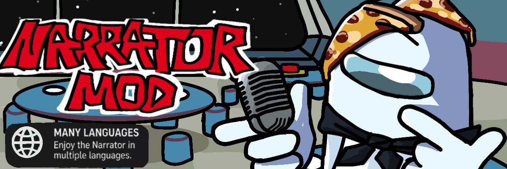

<h1 align="center">Narrator Mod</h1>

## Introduction
It's finally here... after the very short time of 7 months! :3
This mod initially started as a concept via the help of our voice actor, **$ir Jackler** which has now led to the official release.

HUGE thanks to $ir Jackler for his voice, our dev team, art team and last but not least, Pro for making this idea a reality.

Have fun!

> [!NOTE]
> This mod is still in development and may recieve more features in the future, stay tuned!
> Feel free to share your suggestions and ideas.

## Narrations

### Meeting Events
- Fast vote
- Vote at last moment
- Voting almost done
- Voted out as crew
- Voted out as imp
- Voted imp partner
- Skip
- Open chat
- Open the button

### Crew Events

- Taking long on a task
- Taking short on a task
- No task in awhile
- Completing all your tasks

### Impostor Events

-Killing someone

## Other Features

- Credits Menu
- Settings Menu (in lobby)
- Lobby Music
- Narrator Extension API
- Subtitle API
- Condition and Events API

<h5 align="center">This mod is not affiliated with Among Us or Innersloth LLC, and the content contained therein is not endorsed or otherwise sponsored by Innersloth LLC.
Portions of the materials contained herein are the property of Innersloth LLC.</h5>
